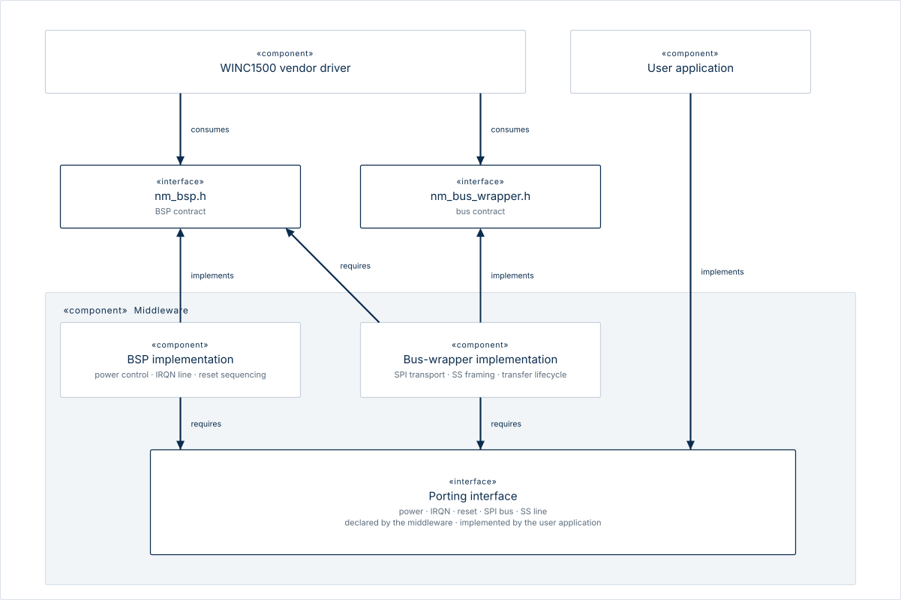
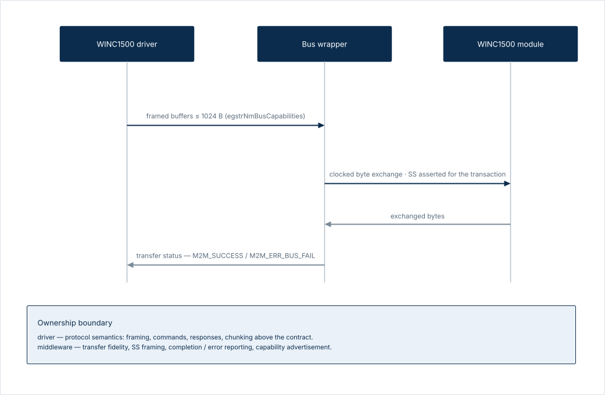
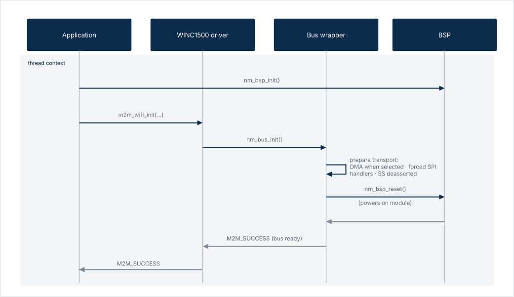
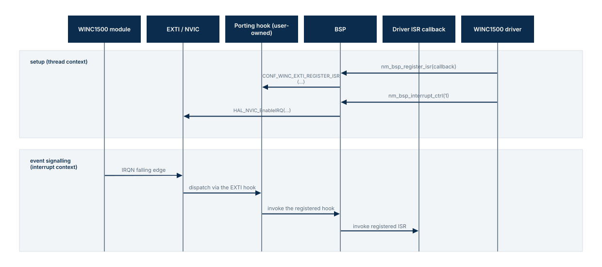
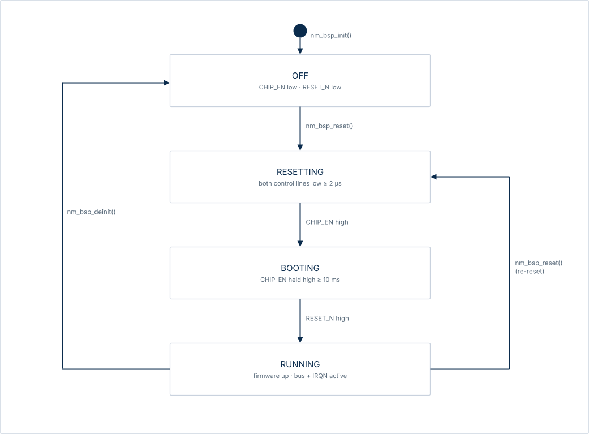

# Software Design Description: STM32F401xE-WINC1500 Middleware
Version 0.1.

## 1. Identification and Overview

This document is the software design description (SDD) of the
STM32F401xE-WINC1500 middleware. It is structured following IEEE Std 1016-2009,
though claims of conformance are delayed until the document is fully elaborated.
Its intended purpose, design subject and environment, and scope are stated
below, and the remaining sections express the design itself. It is a companion
to, and traces to, the software requirements specification (`SRS.md`, v1.0) and
the software architecture description (`SAD.md`, v1.0) of the same middleware.

### 1.1 Identification

| Field                    | Value                                                                                                    |
|--------------------------|----------------------------------------------------------------------------------------------------------|
| Document title           | Software Design Description: STM32F401xE-WINC1500 Middleware                                             |
| Document identifier      | SDD-MW-001                                                                                               |
| Version                  | 0.6                                                                                                      |
| Status                   | Draft                                                                                                    |
| Date of issue            | 2026-10-21                                                                                               |
| Author                   | lowlevelguy                                                                                              |
| Reviewers                | None                                                                                                     |
| Approving authority      | The author                                                                                               |
| Issuing organisation     | Not applicable                                                                                           |
| Configuration management | Version-controlled as a single file in this repository                                                   |
| Governing standard       | IEEE Std 1016-2009                                                                                       |
| Upstream documents       | `SAD.md` (software architecture description, v1.0); `SRS.md` (software requirements specification, v1.0) |

Change history:

| Version | Date       | Description                                                                                                                      |
|---------|------------|----------------------------------------------------------------------------------------------------------------------------------|
| 0.1     | 2026-10-16 | Initial draft (frontispiece and Section 1).                                                                                      |
| 0.2     | 2026-10-17 | Document structure addendum to section 1, and section 2: design stakeholders and concerns.                                       |
| 0.3     | 2026-10-20 | Section 3: design viewpoints.                                                                                                    |
| 0.4     | 2026-10-20 | Section 4: design views.                                                                                                         |
| 0.5     | 2026-10-20 | Section 4 errata: added missing "enable SPI" step in `nm_spi_rw` sequence; fixed reference in §4 to an inexisting table in §3.6. |
| Version | Date       | Description                                                                                                                                                                                                    |
|---------|------------|----------------------------------------------------------------------------------------------------------------------------------------------------------------------------------------------------------------|
| 0.1     | 2026-10-16 | Initial draft (frontispiece and Section 1).                                                                                                                                                                    |
| 0.2     | 2026-10-17 | Document structure addendum to section 1, and section 2: design stakeholders and concerns.                                                                                                                     |
| 0.3     | 2026-10-20 | Section 3: design viewpoints.                                                                                                                                                                                  |
| 0.4     | 2026-10-20 | Section 4: design views.                                                                                                                                                                                       |
| 0.5     | 2026-10-20 | Section 4 errata: added missing "enable SPI" step in `nm_spi_rw` sequence; fixed reference in §4 to an inexisting table in §3.6.                                                                               |
| 0.6     | 2026-10-21 | Section 4 errata: §4.6: fixed "Step 1 to 6" to become "Step 1 to 7" and removed incorrect sentence about SPI enabling placement, added mention of optional WAKE pin; §4.4: added mention of optional WAKE pin. |

### 1.2 Purpose

The purpose of this design description is to express the detailed design of the
design subject: its decomposition into design entities, the allocation of the
SRS requirements to those entities, the interfaces it exposes and consumes, its
interaction and dynamic behaviour, its internal algorithms, its mapping onto the
hardware resources of the target platform, and the design decisions, with their
rationales, that account for its present shape.

The document is intended to serve three uses:

- as the software detailed design required by ASPICE SWE.3;
- as the object of the design-level verification methods planned in the SRS, and
  as a reference for unit-level verification; and
- as a means of communicating the detailed design to the stakeholders identified
  in §2.

It does not restate the requirements or the architecture: the SRS is the
authority on what the middleware shall do, and the SAD on the architecture of
the design subject. Where a design view addresses an architectural element, it
identifies that element's source in the SAD and remains consistent with it;
the design may further refine choices that the architecture leaves open.

### 1.3 Context

#### 1.3.1 Design Subject

The design subject is the STM32F401xE-WINC1500 middleware. It comprises two
parts: the board and transport abstraction layer, and the porting interface.

The board and transport abstraction layer is the implementation, for the
STM32F401xE family of microcontrollers, of the two Hardware Abstraction Layer
interfaces expected by the vendor driver (that is, the Microchip WINC1500
driver): the Board Support Package (BSP) and the bus wrapper.

The BSP is responsible for module power control and module-to-host interrupt
management, while the bus wrapper is responsible for abstracting away data bus
operations from the vendor driver; however, only the parts of the latter that
are relevant to SPI-based communication are implemented.

The porting interface is a surface that the middleware defines for the purposes
of its configuration. By way of it, the middleware obtains application-specific
hardware peripheral mappings and configurations (GPIO, EXTI, SysTick, SPI, and,
optionally, DMA), synchronisation primitives for thread-safe SPI data transfers,
and hooks for module-to-host interrupt and SPI event handling.

#### 1.3.2 Environment

The environment of the design subject is the four-stratum software stack into
which it is embedded. The topmost stratum is the application firmware, followed
by the vendor driver, then our middleware, and finally, at the very bottom, the
STM32 HAL and CMSIS libraries. Going down a stratum thus corresponds to
stripping away a layer of abstraction.

This software stack is physically embedded on an STM32F401xE microcontroller,
connected via SPI to an ATWINC1500 module running its own firmware (version
19.7.11).

The user application &mdash; the application firmware together with the porting
implementation &mdash; is part of the environment, not of the design subject. In
particular, the porting implementation is written by the user and lies outside
the middleware boundary; a reference realisation is cited in this document to
make the porting interface concrete, but its design is not described here.

The runtime environment can be bare metal or an RTOS at the user's discretion;
the middleware is agnostic about the choice, as all blocking and synchronisation
behaviour is obtained through the porting interface.

### 1.4 Scope

This design description covers:

- the board and transport abstraction layer, that is, its BSP and bus wrapper
  (§1.3.1);
- the porting interface, as a contract.

It does not cover, save where needed to describe the design subject's interfaces
and interaction:

- the design of the vendor driver, which is described only as consumed, through
  its call-in and call-out contracts;
- the design of the porting implementation, or of any other part of the user
  application, which appears only as a reference realisation of the porting
  interface; and
- verification on target hardware (testing against the real module), which the
  SRS excludes from its verification scope; the SDD therefore makes no provision
  for it.

### 1.5 Document Structure

The document is structured following the software design description content
requirements of IEEE Std 1016-2009, Clause 4; the mapping is as follows and is
extended as §5 is written.

| Section | Title                            | IEEE Std 1016-2009 clause |
|---------|----------------------------------|---------------------------|
| 1       | Identification and Overview      | 4.2                       |
| 2       | Design Stakeholders and Concerns | 4.3                       |
| 3       | Design Viewpoints                | 4.5, 4.9                  |
| 4       | Design Views                     | 4.4, 4.6                  |

### 1.6 References

- [Software Architecture Description: STM32F401xE-WINC1500 Middleware](SAD.md),
  v1.0.
- [Software Requirements Specification: STM32F401xE-WINC1500
  Middleware](SRS.md), v1.0.
- IEEE Std 1016-2009, *IEEE Standard for Information Technology &mdash; Systems
  Design &mdash; Software Design Descriptions*.
- Microchip ATWINC1500 module datasheet (`DS70005304F`, 2025).
- ATWINC1500 19.7.11 software API reference manual.
- ST STM32F401xE reference manual (`RM0368`, Rev 6, January 2025).

### 1.7 Glossary

This glossary defines the IEEE Std 1016-2009 design-description vocabulary
used in this document. Project terms, including BSP, bus wrapper, porting
interface and IRQN, are defined in SRS §1.4; architecture-description terms
are defined in SAD §1.6 and are not repeated here.

| Term                | Meaning                                                                                                                                                               |
|---------------------|-----------------------------------------------------------------------------------------------------------------------------------------------------------------------|
| Design attribute    | A characteristic or property of a design entity, relationship or constraint.                                                                                          |
| Design concern      | An area of interest with respect to a software design.                                                                                                                |
| Design constraint   | A rule or restriction imposed on a design entity, attribute or relationship.                                                                                          |
| Design element      | An item in a design view: a design entity, relationship, attribute or constraint.                                                                                     |
| Design entity       | A structurally, functionally or otherwise distinct element of a design view, or one that plays a different role relative to other design entities.                    |
| Design overlay      | A representation of additional, detailed or derived design information organised with reference to an existing design view.                                           |
| Design rationale    | Information capturing the reasoning that led to the design, including options, trade-offs, decisions and their justifications.                                        |
| Design relationship | A connection or correspondence between design entities.                                                                                                               |
| Design stakeholder  | An individual, organisation or group (or classes thereof playing the same role) having an interest in, or design concerns relative to, the design of a software item. |
| Design subject      | The middleware described by this SDD. IEEE Std 1016-2009 uses this term in its design vocabulary.                                                                     |
| Design view         | A representation comprising design elements that addresses concerns from a specified design viewpoint.                                                                |
| Design viewpoint    | The specification of the elements and conventions available for constructing and using a design view.                                                                 |

## 2. Design Stakeholders and Concerns

This section identifies the design stakeholders of the middleware and the design
concerns they hold. The identifiers introduced here are used throughout §3, §4
and §5.

### 2.1 Design Stakeholders

Two design stakeholders are identified; the same ones identified in the SAD as
architecture stakeholders.

| ID    | Role                    | Description                                                                                                                                                                                                                                                                                              |
|-------|-------------------------|----------------------------------------------------------------------------------------------------------------------------------------------------------------------------------------------------------------------------------------------------------------------------------------------------------|
| STK-1 | Integrator              | Authors the user application and the porting implementation, and consumes the middleware through the vendor driver. SRS §1.3.1.1 defines the same role as the user of the middleware. The integrator is kept distinct from the maintainer in principle, as the role for which the middleware is written. |
| STK-2 | Maintainer and verifier | The middleware's author, who evolves it against future changes of the SRS and executes the verification methods of SRS §4 &mdash; analysis, inspection and host-executed unit tests.                                                                                                                     |

The design fixes, for the integrator, the porting interface as the sole
adaptation surface, such that the board and transport abstraction layer need
never be modified (REQ-USE-01). For the maintainer, it specifies the design
entities and their contracts so that the host-executed unit tests of SRS §4 can
verify them, and records the design decisions the architecture left open (§5);
both constrain how the middleware may evolve.

The roles above are discharged, in this project, by a single individual; the
integrator role is kept distinct in principle, as it is the role for which the
middleware is written. The single-author situation is the principal resource
limitation of the design effort, and no design concern identified in this
section was left unaddressed on its account.

### 2.2 Design Concerns

Six design concerns are identified. Each concern is presented along with its
statement, the stakeholders that hold it, and the source that grounds it.

The concerns presented are identical to those identified in SAD §2.3. Their
statements are sometimes slightly modified to adapt to the purposes of design,
but are otherwise copied verbatim from the SAD &mdash; even the order is kept
intact.

| ID     | Design concern     | Statement                                                                                                                                                                                                                          | Held by      | Source                               |
|--------|--------------------|------------------------------------------------------------------------------------------------------------------------------------------------------------------------------------------------------------------------------------|--------------|--------------------------------------|
| DCON-1 | Adaptability       | Adapting the middleware to a target application must only require producing a porting implementation.                                                                                                                              | STK-1        | REQ-USE-01                           |
| DCON-2 | Non-intrusiveness  | The middleware must not require changes to the vendor driver or the board and transport abstraction layer, beyond the documented exceptions (SRS §5.1), and must not claim exclusive ownership of the SPI, DMA and EXTI resources. | STK-1, STK-2 | REQ-DES-02, REQ-USE-03               |
| DCON-3 | Concurrency safety | SPI data transfers must be performed from the invoking thread context only; access to internally shared state must be regulated in a thread-safe manner; and blocking waits must return only on transfer completion or failure.    | STK-2        | REQ-ATTR-01, REQ-ATTR-03, REQ-FUN-37 |
| DCON-4 | Host verifiability | Conformance to the SRS must be demonstrable by the host-executed verification methods of SRS §4, without on-target hardware.                                                                                                       | STK-2        | SRS §4                               |
| DCON-5 | Traceability       | Design claims that address an SRS requirement or architectural element must identify it, so that changes expose the affected views; the design may constrain choices the SRS and SAD leave open, but it may not contradict either. | STK-2        | §1.2                                 |
| DCON-6 | Boundary hygiene   | The middleware must only perform byte transport and transaction framing; all protocol semantics must remain owned by the vendor driver.                                                                                            | STK-2        | SAD §4.7                             |

## 3. Design Viewpoints

This section specifies the four design viewpoints that govern the views of
§4. Each specification states the views it governs, its version, the concerns
it frames together with the known stakeholders, the design elements and design
languages available to it, its correspondence and evaluation methods, and its
sources. The design languages are defined once in §3.5 and are
forward-referenced by the viewpoints.

### 3.1 Structure and decomposition

This viewpoint considers the design subject as parts and the ownership
boundaries it keeps. It governs the decomposition view (§4.1) and the protocol
semantics boundary view (§4.2).

| Field                                 | Specification                                                                                                                                                                                                                                                                                                                                                                                                                                                                                           |
|---------------------------------------|---------------------------------------------------------------------------------------------------------------------------------------------------------------------------------------------------------------------------------------------------------------------------------------------------------------------------------------------------------------------------------------------------------------------------------------------------------------------------------------------------------|
| Version                               | 1.0                                                                                                                                                                                                                                                                                                                                                                                                                                                                                                     |
| Views governed                        | Decomposition view (§4.1); protocol semantics boundary view (§4.2)                                                                                                                                                                                                                                                                                                                                                                                                                                      |
| Concerns framed                       | DCON-1 Adaptability; DCON-2 Non-intrusiveness; DCON-5 Traceability; DCON-6 Boundary hygiene                                                                                                                                                                                                                                                                                                                                                                                                             |
| Known stakeholders                    | STK-1 Integrator; STK-2 Maintainer and verifier                                                                                                                                                                                                                                                                                                                                                                                                                                                         |
| Design elements                       | The design entity types of the board and transport abstraction layer: the BSP implementation unit (`nm_bsp_stm32f401xe.c`) and the bus-wrapper implementation unit (`nm_bus_wrapper_stm32f401xe.c`), and their functions (the `nm_bsp_*` and `nm_bus_*` operations, together with their private helpers). The design relationship types that connect them to one another, to the vendor driver and to the porting interface: decomposition (part-of), provides, requires and ownership.                 |
| Design languages                      | Structured English prose; and the block diagram notation of SAD §3.4, incorporated by reference and reused verbatim where a view embeds one (§3.5).                                                                                                                                                                                                                                                                                                                                                     |
| Correspondence and evaluation methods | Decomposition consistency, by inspection: the design entities shown as composing the design subject, and the ownership they keep with the vendor driver, agree across the views of this viewpoint. SRS consistency: claims related to SRS material are checked for contradiction; design refinements of choices left open by the SRS are permitted; the resulting design decisions are recorded in §5. The views of this viewpoint are interpreted by inspection; no formal analysis method is defined. |
| Sources                               | IEEE Std 1016-2009, Clauses 4.5 and 5; SAD §4.2 and §4.7 for the architecture this design refines; SRS §1.3.2 and §3.5 for the parts of the design subject and the constraints on them.                                                                                                                                                                                                                                                                                                                 |

### 3.2 Contracts

This viewpoint considers the contracts the design subject implements, consumes
or defines. It governs the porting interface view (§4.3) and the refined driver
contract view (§4.4).

| Field                                 | Specification                                                                                                                                                                                                                                                                                                                                                                                                                                                                                                                                                                                           |
|---------------------------------------|---------------------------------------------------------------------------------------------------------------------------------------------------------------------------------------------------------------------------------------------------------------------------------------------------------------------------------------------------------------------------------------------------------------------------------------------------------------------------------------------------------------------------------------------------------------------------------------------------------|
| Version                               | 1.0                                                                                                                                                                                                                                                                                                                                                                                                                                                                                                                                                                                                     |
| Views governed                        | Porting interface view (§4.3); refined driver contract view (§4.4)                                                                                                                                                                                                                                                                                                                                                                                                                                                                                                                                      |
| Concerns framed                       | DCON-1 Adaptability; DCON-2 Non-intrusiveness; DCON-5 Traceability; DCON-6 Boundary hygiene                                                                                                                                                                                                                                                                                                                                                                                                                                                                                                             |
| Known stakeholders                    | STK-1 Integrator; STK-2 Maintainer and verifier                                                                                                                                                                                                                                                                                                                                                                                                                                                                                                                                                         |
| Design elements                       | The interface entity types: the driver-facing operations the middleware implements (`nm_bsp_*`, `nm_bus_*` and `nm_spi_rw`), the capabilities instance it advertises (`egstrNmBusCapabilities`), and the porting interface it consumes, the `CONF_WINC_*` configuration macros. Their attribute types: signature, return code, parameter semantics, and resource binding &mdash; the SPI instance, the DMA streams, the EXTI line and the GPIO pins. Their constraint types: the forced SPI configuration, manual Slave Select, the read/write-only driver interface, and the `u16MaxTrxSz` capability. |
| Design languages                      | Structured English prose; the interface-contract table notation (§3.5); and the block diagram notation of SAD §3.4, incorporated by reference and reused verbatim where a view embeds one.                                                                                                                                                                                                                                                                                                                                                                                                              |
| Correspondence and evaluation methods | Interface consistency, by inspection: each operation appears in every view in which it occurs with the same signature, return code and semantics. SRS consistency: claims related to SRS material are checked for contradiction; design refinements of choices left open by the SRS are permitted; the resulting design decisions are recorded in §5. The views of this viewpoint are interpreted by inspection; no formal analysis method is defined.                                                                                                                                                  |
| Sources                               | IEEE Std 1016-2009, Clauses 4.5 and 5; SRS §3.1 and §3.4 for the interface inventory; SAD §4.2 for the architectural contracts this design refines, and §6 (DEC-02) for the porting interface as compile-time hooks.                                                                                                                                                                                                                                                                                                                                                                                    |

### 3.3 Interaction

This viewpoint considers the design subject as behaviour ordered in time. It
governs the bring-up view (§4.5), the SPI transaction view (§4.6) and the
event delivery view (§4.7).

| Field                                 | Specification                                                                                                                                                                                                                                                                                                                                                                                                                              |
|---------------------------------------|--------------------------------------------------------------------------------------------------------------------------------------------------------------------------------------------------------------------------------------------------------------------------------------------------------------------------------------------------------------------------------------------------------------------------------------------|
| Version                               | 1.0                                                                                                                                                                                                                                                                                                                                                                                                                                        |
| Views governed                        | Bring-up view (§4.5); SPI transaction view (§4.6); event delivery view (§4.7)                                                                                                                                                                                                                                                                                                                                                              |
| Concerns framed                       | DCON-3 Concurrency safety; DCON-4 Host verifiability; DCON-5 Traceability                                                                                                                                                                                                                                                                                                                                                                  |
| Known stakeholders                    | STK-2 Maintainer and verifier                                                                                                                                                                                                                                                                                                                                                                                                              |
| Design elements                       | The interaction types invocation and notification; their attribute types: execution context (thread or interrupt), ordering, and the synchronisation point at which a wait ends; and their constraint types: notifications originate only in interrupt context; blocking waits occur only in thread context; and the bus is released on both completion and failure.                                                                       |
| Design languages                      | Structured English prose; and the sequence diagram notation of SAD §3.4, incorporated by reference and reused verbatim where a view embeds one.                                                                                                                                                                                                                                                                                            |
| Correspondence and evaluation methods | Context consistency, by inspection: the thread or interrupt annotation of each interaction agrees across the views of this viewpoint. SRS consistency: claims related to SRS material are checked for contradiction; design refinements of choices left open by the SRS are permitted; the resulting design decisions are recorded in §5. The views of this viewpoint are interpreted by inspection; no formal analysis method is defined. |
| Sources                               | IEEE Std 1016-2009, Clauses 4.5 and 5; SRS §3.1.3 for synchronisation and bus ownership; the ATWINC1500 19.7.11 software API reference manual for call semantics; SAD §4.3–§4.5 for the architectural interactions this design refines.                                                                                                                                                                                                    |

### 3.4 State dynamics

This viewpoint considers the design subject's modes and the reactions to events
that move it between them. It governs the module power lifecycle view (§4.8).

| Field                                 | Specification                                                                                                                                                                                                                                                                                                                                                                                                                    |
|---------------------------------------|----------------------------------------------------------------------------------------------------------------------------------------------------------------------------------------------------------------------------------------------------------------------------------------------------------------------------------------------------------------------------------------------------------------------------------|
| Version                               | 1.0                                                                                                                                                                                                                                                                                                                                                                                                                              |
| Views governed                        | Module power lifecycle view (§4.8)                                                                                                                                                                                                                                                                                                                                                                                               |
| Concerns framed                       | DCON-3 Concurrency safety; DCON-4 Host verifiability; DCON-5 Traceability                                                                                                                                                                                                                                                                                                                                                        |
| Known stakeholders                    | STK-2 Maintainer and verifier                                                                                                                                                                                                                                                                                                                                                                                                    |
| Design elements                       | The entity types state, transition and event (trigger); the attribute type initial state; and the constraint types: guard conditions, such as the condition that transfers are legal only while the module is running.                                                                                                                                                                                                           |
| Design languages                      | Structured English prose; the state machine diagram notation of SAD §3.4, incorporated by reference and reused verbatim where the view embeds one; and the state-transition table notation (§3.5).                                                                                                                                                                                                                               |
| Correspondence and evaluation methods | Lifecycle consistency, by inspection: the states in which SPI transfers are legal agree with the SPI transaction view (§4.6). SRS consistency: claims related to SRS material are checked for contradiction; design refinements of choices left open by the SRS are permitted; the resulting design decisions are recorded in §5. The view of this viewpoint is interpreted by inspection; no formal analysis method is defined. |
| Sources                               | IEEE Std 1016-2009, Clauses 4.5 and 5; SRS §3.1.1 for the BSP's power-control and interrupt-management behaviour; SAD §4.6 for the architectural lifecycle this design refines; the ATWINC1500 module datasheet for the reset timing.                                                                                                                                                                                            |

### 3.5 Design languages

The viewpoints above use three design languages.

- English prose is the default: ordering, constraints and rationales are
  stated in sentences, using the identifiers of §2 and of the source code.

- Tabulars record one design element per row, with the header row naming the
  properties recorded in the columns below it.

- Diagrams are the block diagram, sequence diagram and state machine diagram
  notations of SAD §3.4, imported by reference and not restated; the views of
  §4 reuse them verbatim wherever one depicts the design unchanged, so their
  conventions remain those of §3.4.

The conventions of a language are the legend for every view component that
uses it; the reading notes of §4, where present, add view-specific guidance
but do not override them.

### 3.6 Coverage

Every design concern is framed by at least one viewpoint; the matrix below
records it, with a row per concern and a column per viewpoint. DCON-5 is
framed by every viewpoint: every view makes claims that must identify their
SRS and SAD sources.

|        | 3.1 Structure and decomposition | 3.2 Contracts | 3.3 Interaction | 3.4 State dynamics |
|--------|---------------------------------|---------------|-----------------|--------------------|
| DCON-1 | yes                             | yes           | &mdash;         | &mdash;            |
| DCON-2 | yes                             | yes           | &mdash;         | &mdash;            |
| DCON-3 | &mdash;                         | &mdash;       | yes             | yes                |
| DCON-4 | &mdash;                         | &mdash;       | yes             | yes                |
| DCON-5 | yes                             | yes           | yes             | yes                |
| DCON-6 | yes                             | yes           | &mdash;         | &mdash;            |

## 4. Design Views

This section contains the design views of the middleware. Each view is governed
by a design viewpoint, as we already presented, and closes with mention
of the SAD material it refines and the SRS requirements it must satisfy.

### 4.1 Decomposition

This view shows the design subject decomposed into its two implementation
units, the relationships that bind those units to the vendor driver and to the
porting interface, and the private helpers they own.

The design subject contains two implementation units: the BSP implementation
unit, `nm_bsp_stm32f401xe.c`; and the bus-wrapper implementation unit,
`nm_bus_wrapper_stm32f401xe.c`, for the SPI part of the interface.

Each unit defines helper functions; all are `static` except `irqn_on_irq`,
which the porting interface installs as the EXTI handler:

| Helper                  | Unit        | Responsibility                                                                                                                      |
|-------------------------|-------------|-------------------------------------------------------------------------------------------------------------------------------------|
| `module_ctrl_pins_init` | BSP         | Configures the CHIP_EN, RESET_N and IRQN GPIOs, the WAKE pin when enabled, and drives the control pins to their powered-off levels. |
| `irqn_on_irq`           | BSP         | EXTI callback: filters on the IRQN pin and invokes the registered driver ISR.                                                       |
| `spi_assert_ss`         | Bus wrapper | Drives SS low.                                                                                                                      |
| `spi_deassert_ss`       | Bus wrapper | Drives SS high.                                                                                                                     |
| `spi_on_irq_success`    | Bus wrapper | Filters on the SPI instance and signals transfer completion.                                                                        |
| `spi_on_irq_error`      | Bus wrapper | Filters on the SPI instance and signals transfer failure.                                                                           |

Source: SAD §4.2, §4.7; requirements: REQ-USE-01, REQ-DES-01, REQ-DES-03,
REQ-IF-05–11.

### 4.2 Protocol semantics boundary

This view shows where the middleware's byte transport ends and the vendor
driver's protocol semantics begin.

A related constraint belongs to the same boundary. The capabilities instance
advertises a maximum transfer size, and the middleware trusts the driver to
respect it: it neither enforces the limit nor fragments transfers itself
(DEC-05).

Source: SAD §4.7; requirements: SRS §1.2, SRS §3.1.2, REQ-DES-01, REQ-DES-03.

### 4.3 Porting interface

This view shows the porting interface as the inventory of `CONF_WINC_*`
macros, with the form each must take:

| Macro                                | Kind          | Required form                         | Meaning                                                           |
|--------------------------------------|---------------|---------------------------------------|-------------------------------------------------------------------|
| `CONF_WINC_DEBUG`                    | value         | `0` or `1`                            | Enables the debug output of the common layer when 1               |
| `CONF_WINC_PRINTF`                   | function-like | printf-style variadic                 | Debug output sink; its return value is ignored                    |
| `CONF_WINC_SYSTEM_CLOCK_INIT`        | function-like | `void (void)`                         | Configures the system clock                                       |
| `CONF_WINC_IRQN_PORT`                | value         | `GPIO_TypeDef*`                       | GPIO port of IRQN                                                 |
| `CONF_WINC_IRQN_PIN`                 | value         | `uint16`                              | GPIO pin of IRQN                                                  |
| `CONF_WINC_CHIP_EN_PORT`             | value         | `GPIO_TypeDef*`                       | GPIO port of CHIP_EN                                              |
| `CONF_WINC_CHIP_EN_PIN`              | value         | `uint16`                              | GPIO pin of CHIP_EN                                               |
| `CONF_WINC_RESET_N_PORT`             | value         | `GPIO_TypeDef*`                       | GPIO port of RESET_N                                              |
| `CONF_WINC_RESET_N_PIN`              | value         | `uint16`                              | GPIO pin of RESET_N                                               |
| `CONF_WINC_USE_WAKE_PIN`             | value         | `0` or `1`                            | Enables the WAKE pin when 1                                       |
| `CONF_WINC_WAKE_PORT`                | value         | `GPIO_TypeDef*`                       | GPIO port of WAKE                                                 |
| `CONF_WINC_WAKE_PIN`                 | value         | `uint16`                              | GPIO pin of WAKE                                                  |
| `CONF_WINC_IRQN_EXTI_LINE`           | value         | `IRQn_Type`                           | EXTI/NVIC line serving IRQN                                       |
| `CONF_WINC_EXTI_REGISTER_ISR`        | function-like | `void (void (*)(uint16_t))`           | Installs the EXTI callback                                        |
| `CONF_WINC_EXTI_DEREGISTER_ISR`      | function-like | `void (void)`                         | Clears the EXTI callback                                          |
| `CONF_WINC_USE_SPI`                  | selector      | &mdash;                               | Selects the SPI transport                                         |
| `CONF_WINC_SPI_USE_DMA`              | selector      | &mdash;                               | Selects DMA transfers                                             |
| `CONF_WINC_SPI_HANDLE`               | object        | `SPI_HandleTypeDef`                   | SPI handle used by the middleware                                 |
| `CONF_WINC_SPI_INSTANCE`             | value         | `uint32`                              | SPI instance identifier of that handle                            |
| `CONF_WINC_SPI_IRQN`                 | value         | `IRQn_Type`                           | NVIC interrupt of that SPI instance                               |
| `CONF_WINC_SPI_SS_PORT`              | value         | `GPIO_TypeDef*`                       | GPIO port of SS                                                   |
| `CONF_WINC_SPI_SS_PIN`               | value         | `uint16`                              | GPIO pin of SS                                                    |
| `CONF_WINC_SPI_BUS_ACQUIRE`          | function-like | `void (void)`                         | Blocks until the bus is free, then takes it                       |
| `CONF_WINC_SPI_BUS_RELEASE`          | function-like | `void (void)`                         | Frees the bus                                                     |
| `CONF_WINC_SPI_SYNC_PREPARE`         | function-like | `void (void)`                         | Clears the completion and error flags                             |
| `CONF_WINC_SPI_SYNC_WAIT`            | function-like | `void (void)`                         | Blocks until the transfer completes or fails                      |
| `CONF_WINC_SPI_SYNC_NOTIFY`          | function-like | `void (void)`                         | Signals success                                                   |
| `CONF_WINC_SPI_SYNC_NOTIFY_ERR`      | function-like | `void (void)`                         | Signals failure                                                   |
| `CONF_WINC_SPI_SYNC_ERR_STATUS`      | expression    | `int`                                 | Yields 1 when the last transfer failed                            |
| `CONF_WINC_SPI_REGISTER_TX_ISR`      | function-like | `void (void (*)(SPI_HandleTypeDef*))` | Installs the TX handler                                           |
| `CONF_WINC_SPI_REGISTER_RX_ISR`      | function-like | `void (void (*)(SPI_HandleTypeDef*))` | Installs the RX handler                                           |
| `CONF_WINC_SPI_REGISTER_TX_RX_ISR`   | function-like | `void (void (*)(SPI_HandleTypeDef*))` | Installs the TX/RX handler                                        |
| `CONF_WINC_SPI_REGISTER_ERROR_ISR`   | function-like | `void (void (*)(SPI_HandleTypeDef*))` | Installs the error handler                                        |
| `CONF_WINC_SPI_DEREGISTER_TX_ISR`    | function-like | `void (void)`                         | Clears the TX handler                                             |
| `CONF_WINC_SPI_DEREGISTER_RX_ISR`    | function-like | `void (void)`                         | Clears the RX handler                                             |
| `CONF_WINC_SPI_DEREGISTER_TX_RX_ISR` | function-like | `void (void)`                         | Clears the TX/RX handler                                          |
| `CONF_WINC_SPI_DEREGISTER_ERROR_ISR` | function-like | `void (void)`                         | Clears the error handler                                          |
| `CONF_WINC_SPI_DMA_TX_HANDLE`        | object        | `DMA_HandleTypeDef`                   | DMA handle of the TX stream                                       |
| `CONF_WINC_SPI_DMA_TX_INIT`          | function-like | `HAL_StatusTypeDef (void)`            | Initialises the TX stream                                         |
| `CONF_WINC_SPI_DMA_TX_IRQN`          | value         | `IRQn_Type`                           | NVIC interrupt of that TX stream                                  |
| `CONF_WINC_SPI_DMA_RX_HANDLE`        | object        | `DMA_HandleTypeDef`                   | DMA handle of the RX stream                                       |
| `CONF_WINC_SPI_DMA_RX_INIT`          | function-like | `HAL_StatusTypeDef (void)`            | Initialises the RX stream                                         |
| `CONF_WINC_SPI_DMA_RX_IRQN`          | value         | `IRQn_Type`                           | NVIC interrupt of that RX stream                                  |
| `CONF_WINC_USE_I2C`                  | selector      | &mdash;                               | Non-SPI bus selection, rejected at compile time by the middleware |
| `CONF_WINC_USE_UART`                 | selector      | &mdash;                               | Non-SPI bus selection, rejected at compile time by the middleware |

Source: SAD §4.2, §6 (DEC-02); requirements: REQ-IF-05–11.

### 4.4 Refined driver contract

This view refines the vendor contract of the BPS and bus wrapper interfaces:
for each element, the signature the vendor declares, the return code and the
semantics the design subject realises, and the SRS requirements it meets:

| Interface element        | Signature                                                       | Return code                                                | Semantics                                                                                                                                                                                                                                                                                                                                                  | Requirement                |
|--------------------------|-----------------------------------------------------------------|------------------------------------------------------------|------------------------------------------------------------------------------------------------------------------------------------------------------------------------------------------------------------------------------------------------------------------------------------------------------------------------------------------------------------|----------------------------|
| `nm_bsp_init`            | `sint8 nm_bsp_init(void*)`                                      | `M2M_SUCCESS`                                              | Clears the driver callback, ensures the system clock, configures the control pins with IRQN on a falling edge with the internal pull-up, deregisters the EXTI callback, enables the IRQN interrupt, and drives the control pins low.                                                                                                                       | REQ-FUN-01–04              |
| `nm_bsp_deinit`          | `sint8 nm_bsp_deinit(void)`                                     | `M2M_SUCCESS`                                              | Disables the IRQN NVIC line, deregisters the EXTI callback, and deinitialises the control pins.                                                                                                                                                                                                                                                            | REQ-FUN-05–06              |
| `nm_bsp_reset`           | `void nm_bsp_reset(void)`                                       | &mdash;                                                    | Drives CHIP_EN and RESET_N low for 1 ms, raises CHIP_EN, waits 10 ms, then raises RESET_N; WAKE, when enabled, is driven low with CHIP_EN and RESET_N and raised with RESET_N.                                                                                                                                                                             | REQ-FUN-07–08              |
| `nm_bsp_sleep`           | `void nm_bsp_sleep(uint32 u32TimeMsec)`                         | &mdash;                                                    | Calls `HAL_Delay` for the requested number of milliseconds.                                                                                                                                                                                                                                                                                                | REQ-FUN-09                 |
| `nm_bsp_register_isr`    | `void nm_bsp_register_isr(tpfNmBspIsr pfIsr)`                   | &mdash;                                                    | Stores the callback and installs `irqn_on_irq` as the EXTI callback.                                                                                                                                                                                                                                                                                       | REQ-FUN-10                 |
| `nm_bsp_interrupt_ctrl`  | `void nm_bsp_interrupt_ctrl(uint8 u8Enable)`                    | &mdash;                                                    | Enables the IRQN NVIC line at priority 0 when `u8Enable` is 1, and disables it when it is 0.                                                                                                                                                                                                                                                               | REQ-FUN-11                 |
| `nm_bus_init`            | `sint8 nm_bus_init(void*)`                                      | `M2M_SUCCESS` or `M2M_ERR_BUS_FAIL`                        | Configures DMA when selected, forces the SPI configuration &mdash; master, two lines, 8-bit, clock polarity low, clock phase on the first edge, software slave select, most significant bit first, no CRC, prescaler 4 &mdash; registers the four SPI handlers, enables the SPI and DMA interrupts at priority 0, deasserts SS, then calls `nm_bsp_reset`. | REQ-FUN-12–19, REQ-PERF-01 |
| `nm_bus_deinit`          | `sint8 nm_bus_deinit(void)`                                     | `M2M_SUCCESS`                                              | Deinitialises the SS pin and deregisters the SPI handlers, leaving the SPI and DMA interfaces untouched.                                                                                                                                                                                                                                                   | REQ-FUN-20–22              |
| `nm_bus_ioctl`           | `sint8 nm_bus_ioctl(uint8 u8Cmd, void* pvParameter)`            | `M2M_SUCCESS`, `M2M_ERR_BUS_FAIL` or `M2M_ERR_INVALID_ARG` | Dispatches `NM_BUS_IOCTL_RW` to `nm_spi_rw`, and returns `M2M_ERR_INVALID_ARG` for any other command.                                                                                                                                                                                                                                                      | REQ-FUN-23–26              |
| `nm_bus_reinit`          | `sint8 nm_bus_reinit(void* config)`                             | `M2M_SUCCESS`                                              | Empty stub; the driver makes no reference to it (DEC-03).                                                                                                                                                                                                                                                                                                  | &mdash;                    |
| `nm_spi_rw`              | `sint8 nm_spi_rw(uint8* pu8Mosi, uint8* pu8Miso, uint16 u16Sz)` | `M2M_SUCCESS` or `M2M_ERR_BUS_FAIL`                        | Validates the size and buffers, acquires the bus, asserts SS, prepares the synchronisation mechanism, starts the transmit-only, receive-only or full-duplex transfer, waits, and on either outcome deasserts SS and releases the bus.                                                                                                                      | REQ-FUN-27–37              |
| `egstrNmBusCapabilities` | `tstrNmBusCapabilities egstrNmBusCapabilities`                  | &mdash;                                                    | Advertises a maximum transfer size of 1024 bytes through `u16MaxTrxSz`; the limit is trusted, not enforced (DEC-05).                                                                                                                                                                                                                                       | REQ-PERF-02                |

Source: SAD §4.2; requirements: SRS §3.1.1–§3.1.3, REQ-DES-01, REQ-DES-03.

### 4.5 Bring-up

This view shows the ordered steps that take the module from a powered-off board
to a running module.

WAKE is not part of the sequence the module requires, so the diagram omits it;
when the pin is enabled, it is driven low with CHIP_EN and RESET_N and raised
with RESET_N (DEC-01, DDEC-08).

Firmware boot and event servicing, once the bus is ready, are driver concerns
and lie outside the design subject.

Source: SAD §4.3; requirements: REQ-FUN-01–02, REQ-FUN-07–08, REQ-FUN-12–18.

### 4.6 SPI transaction

This view shows one `nm_spi_rw` transaction as ordered steps, together with the
execution context in which the steps run.

1. Validate the transfer: a size of zero, or both buffers NULL, is rejected
   with `M2M_ERR_BUS_FAIL` before any bus access.
2. Acquire the SPI bus through the porting interface.
3. Enable the SPI interface.
4. Assert SS.
5. Prepare the synchronisation mechanism.
6. Start the HAL transfer: transmit-only, receive-only or full-duplex, over DMA
   or over interrupts according to `CONF_WINC_SPI_USE_DMA`.
7. Wait for completion or failure.
8. On failure, deassert SS, release the bus and return `M2M_ERR_BUS_FAIL`.
9. On success, deassert SS, release the bus and return `M2M_SUCCESS`.

Steps 1 to 7 run in thread context. The notifications that end the wait are
raised from interrupt context; the middleware starts no transfer from an
interrupt handler.

Source: SAD §4.4, §6 (DEC-06); requirements: REQ-FUN-27–38, REQ-IF-08–09.

### 4.7 Event delivery

This view shows how module and SPI events reach the vendor driver, and where
the middleware's participation in them ends.

Registration runs in thread context. `nm_bsp_register_isr` stores the driver
callback and installs `irqn_on_irq`; `nm_bus_init` installs
`spi_on_irq_success` for the transmit, receive and transmit-receive events, and
`spi_on_irq_error` for the error event.

The asynchronous path then runs entirely in interrupt context: `irqn_on_irq`
filters on the IRQN pin and invokes the driver callback, while
`spi_on_irq_success` and `spi_on_irq_error` filter on the SPI instance and
signal success or failure through the porting interface.

Source: SAD §4.5; requirements: REQ-FUN-10, REQ-FUN-16, REQ-FUN-38,
REQ-IF-06–07.

### 4.8 Module power lifecycle

This view shows the states the module passes through under the design subject's
control, and the transitions between them.

Transfers are legal only in RUNNING, and the SPI transaction view (§4.6)
assumes that state. Readiness polling after RESET_N rises, and all event
servicing, are external to the design subject.

Source: SAD §4.6; requirements: REQ-FUN-01–02, REQ-FUN-07–08, REQ-FUN-18.
